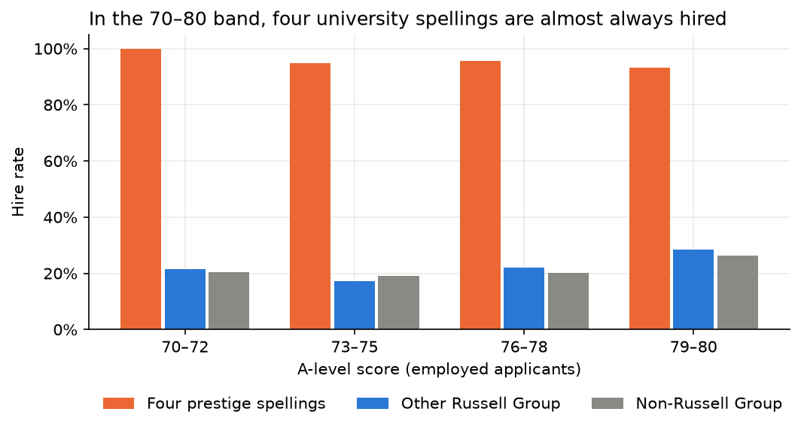
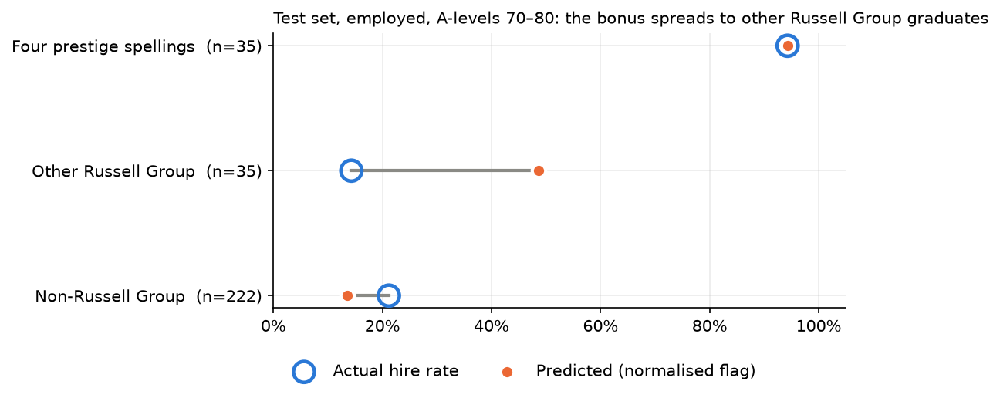
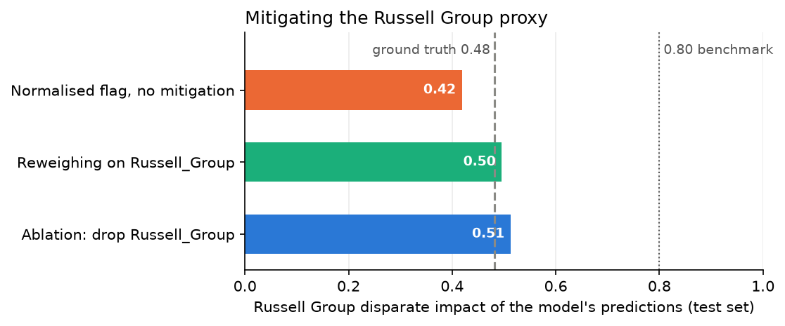

# LightHR fairness audit

[](https://github.com/koye12312/lighthr-fairness-audit/actions/workflows/tests.yml)

An end-to-end audit of a hiring classifier for **LightHR**, a fictional recruitment firm: train a model that shortlists candidates, explain its decisions, and test whether it treats protected groups fairly.

Started as university coursework in data analysis and visualisation. `01_lighthr_audit.ipynb` is the main pipeline; `02_follow_up.ipynb` takes the fairness analysis further and found the largest bias in the data.

## Headline findings

**1. The main pipeline** ([`01_lighthr_audit.ipynb`](notebooks/01_lighthr_audit.ipynb))

- Five tuned classifiers. AdaBoost was selected on CV accuracy (0.970 ± 0.005) and scored test F1 0.950 on the hired class, with ROC AUC 0.998.
- SHAP and LIME agree on what drives decisions (Spearman ρ ≈ 0.88): A-levels dominate, followed by referees and employment sector. Gender ranks ninth.
- Group fairness (aif360) on nine protected splits. Male vs Non-binary (disparate impact 0.675) and Russell Group vs non-Russell Group (0.630) fail the 0.80 benchmark.
- Gender Reweighing improves most gender splits at no accuracy cost (0.976 → 0.977), but leaves Russell Group untouched.

**2. The follow-up** ([`02_follow_up.ipynb`](notebooks/02_follow_up.ipynb))

The dataset spells some universities several ways (`" University of Oxford"` with a leading space, `"Universirt of Cambridge"`, `"University of Nottingham, The"`, …). Normalising names before matching (`lighthr/universities.py`) finds **588 more Russell Group graduates** than exact matching.

Those extra matches reveal a **prestige bonus** in the labels. Employed applicants with A-levels of 70–80 (the only band where the hiring decision is not fixed by simple rules) are hired about 20% of the time. From four specific university spellings, it is 85–100%.



With the normalised flag the model becomes **more accurate and less fair**. Accuracy rises from 0.976 to 0.980 and the model's Russell Group disparate impact falls from 0.630 to 0.419, below the 0.482 already in the labels. The model learns the bonus and **spreads it to every Russell Group graduate**:



The follow-up also extends the fairness analysis in two directions:

- **More privileged/unprivileged definitions.** There are 14 splits, each tagged as a protected characteristic, a proxy or job-relevant, including one-vs-rest gender, age extremes, the COVID cohort separated from 2022, and employment and references as a sanity check that disparate impact alone is not a verdict.
- **Deeper individual fairness.** Consistency is broken down by group, with and without the Russell Group proxy in the similarity space. Counterfactual flips cover every protected attribute: gender and age flips change 0% of predictions, Russell Group changes 5.5%, and all 96 affected applicants are employed with A-levels of 70–80.

Finally, it runs and compares two Russell Group mitigations:



| Model | Accuracy | Russell Group DI | Non-binary DI |
|---|---|---|---|
| Normalised flag, no mitigation | 0.980 | 0.419 | 0.851 |
| Ablation (drop `Russell_Group`) | 0.978 | 0.513 | **0.734** |
| Reweighing on Russell Group | 0.981 | 0.496 | **0.780** |

Both remove the amplification, but both push the Non-binary split below 0.80. **Fixing one disparity moved another.** Mitigation has to be checked against every split, not just the one being targeted.

## What's in the repo

```
notebooks/
  01_lighthr_audit.ipynb   the main pipeline (outputs included)
  02_follow_up.ipynb       name matching, the hidden bias, extended fairness analysis, mitigations
lighthr/
  universities.py          Russell Group matching that survives messy spellings
  pipeline.py              preprocessing and the final AdaBoost model as functions
tests/
  test_universities.py     31 tests: every messy spelling matches, and look-alikes
                           (Oxford Brookes, Sheffield Hallam, ...) do not
docs/figures/              every figure the notebooks produce
```

The pipeline in brief:

| Part | What | Methods |
|---|---|---|
| Preprocessing | 8,800 applicants, 15 columns | missing employment read as unemployed, four engineered referee features, Russell Group flag |
| A. Exploration | patterns in who gets hired | Apriori (support 0.05, lift > 1), K-medoids with cosine distance on rejected applicants, rules within clusters |
| B. Classification | five models | Decision Tree, Bagging, Random Forest, AdaBoost, XGBoost; GridSearchCV with 5-fold stratified CV |
| C. Explainability | why the model decides | SHAP (global, beeswarm, dependence), LIME on 10 records, Spearman agreement |
| D. Fairness | is it fair | aif360 DI / SPD / EOD / AOD / Theil, intersectional rates, k-NN consistency (Euclidean and Gower), counterfactual flips, Reweighing |

## Running it

```bash
python -m venv .venv && source .venv/bin/activate     # Python 3.12
pip install -r requirements.txt
# put LightHR_dataset.csv in data/ (see data/README.md)
pytest
jupyter nbconvert --to notebook --execute --inplace notebooks/01_lighthr_audit.ipynb
jupyter nbconvert --to notebook --execute --inplace notebooks/02_follow_up.ipynb
```

The dataset is not redistributed here. The tests do not need it. XGBoost results and the SHAP–LIME correlation can vary slightly between library versions and runs; no conclusion depends on them.

## Limitations

- LightHR is synthetic. The prestige bonus follows specific records rather than universities (correctly spelled Oxford is hired at 23%, the leading-space spelling at 100%), which suggests it was planted. In real data the same pattern would point at one recruiter, office or data source, and would need investigating before modelling.
- Some follow-up subgroups are small (35 applicants per group in the 70–80 band of the test set; 75 in the 2022 cohort), so exact rates are noisy. The direction of each effect is consistent across group metrics, consistency and counterfactuals.
- Disparate impact benchmarks such as 0.80 come from US employment guidance. They are used here as a reference point, not a legal test.
